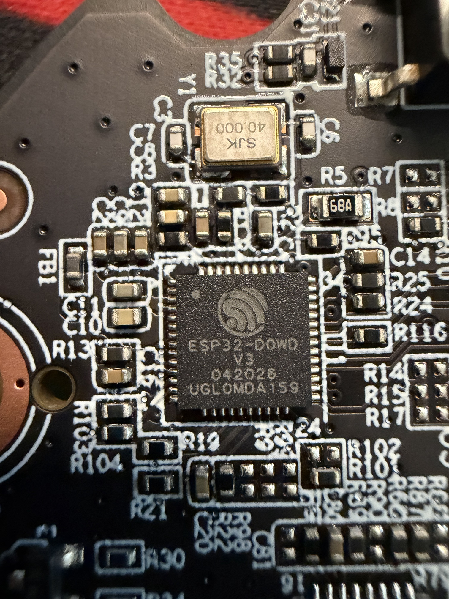
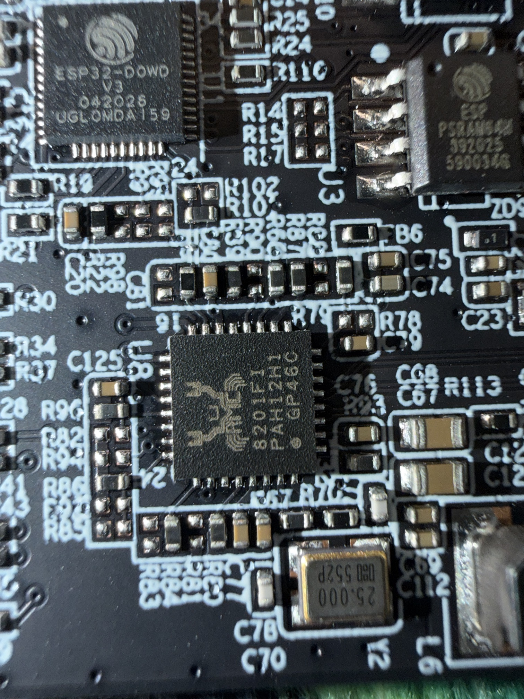
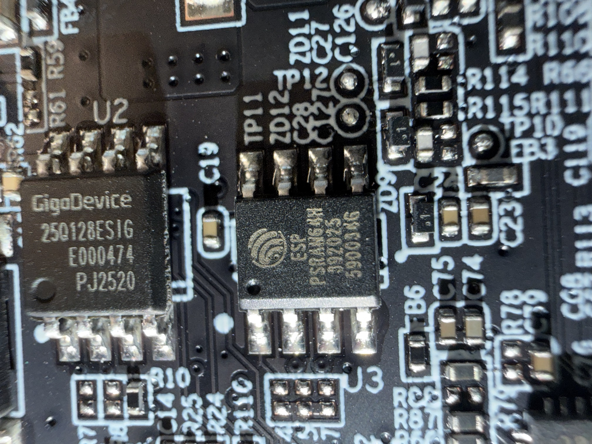
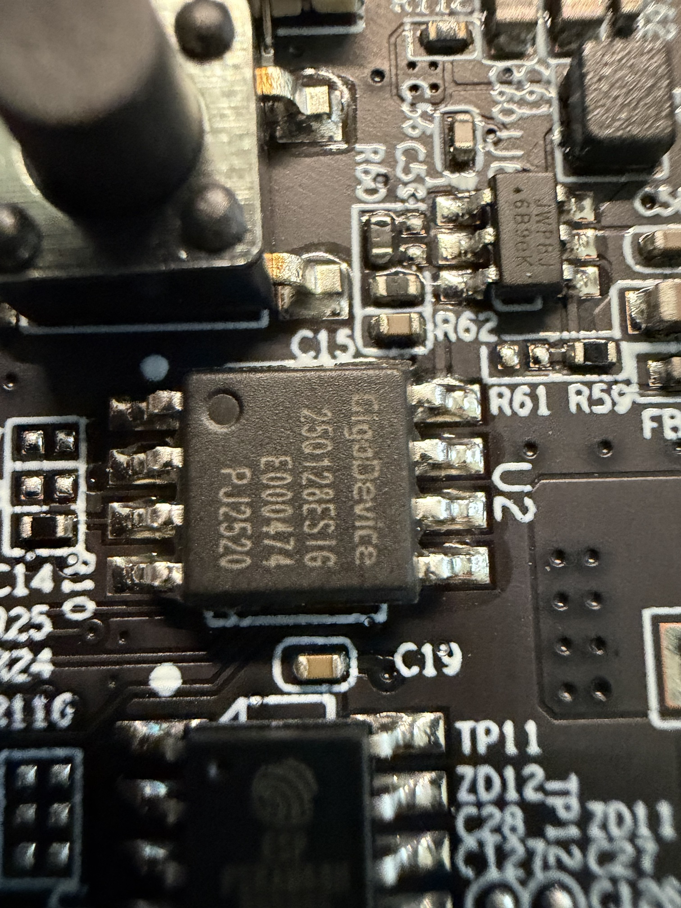
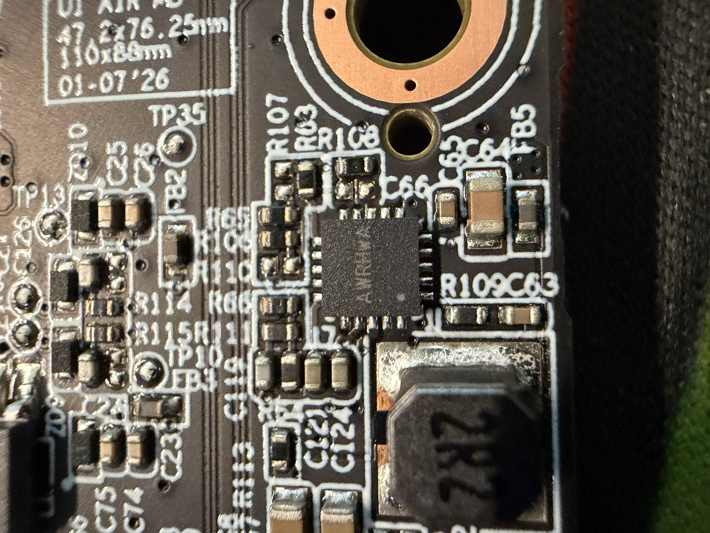
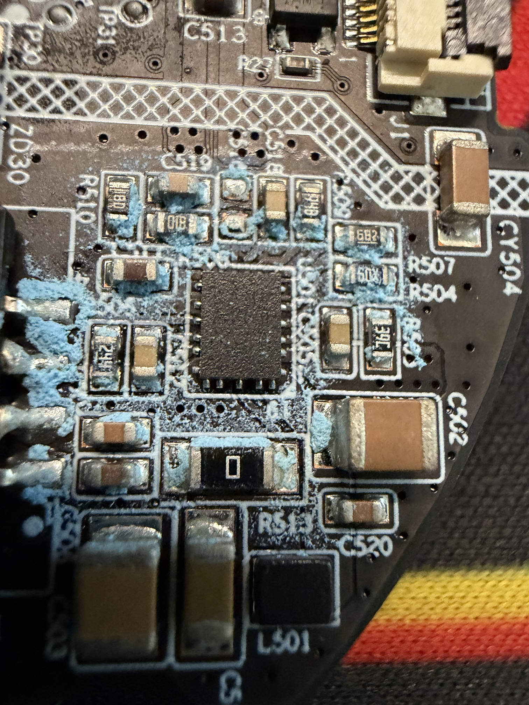
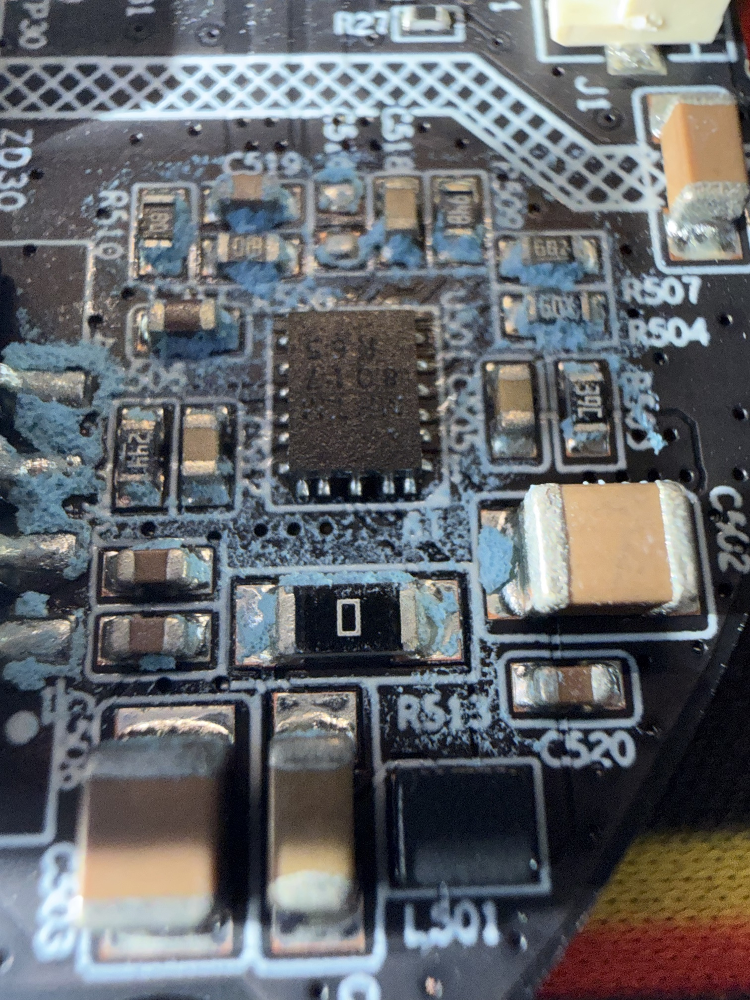
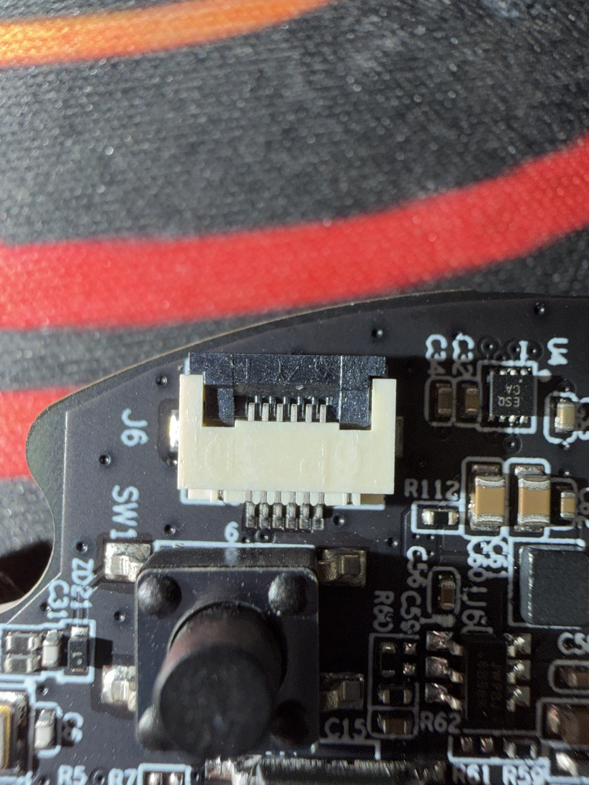
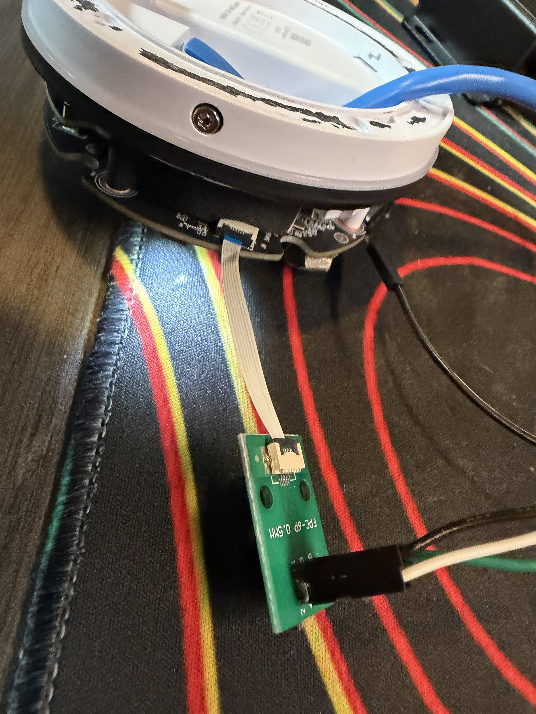

# Hardware

All IDs read from package markings and confirmed against the boot log where possible.
Board silkscreen: **UP AIR**, 47.2 × 76.25 mm / 110 × 88 mm, dated **01-07'26**.

## Photos

| | |
|---|---|
|  |  |
| **U1** ESP32-D0WD-V3 (`042026` / `UGL0MDA159`) and `Y1` 40.000 MHz crystal | **U1** ESP32 (top-left), **U3** ESP-PSRAM64H (top-right), **U8** RTL8201F PHY (center) |
|  |  |
| **U2** GigaDevice `25Q128ESIG` (16 MB flash) + **U3** `ESP-PSRAM64H` | **U2** flash close-up (`E000474` / `PJ2520`) |
|  |  |
| Buck converter (`AWRHWA`) + `2R2` inductor; silk date `01-07'26` | Second power QFN near `L501` / `C402` / `ZD30` (flux residue) |
|  |  |
| Power QFN close-up (top mark unreadable) | **J6** 6-pin 0.5 mm FFC service port, `SW1` button, ESD array |
|  | |
| The `FPC-6P 0.5MM` breakout + 6-conductor FFC used to reach the console | |

## Major components

| Ref | Part | Notes |
|-----|------|-------|
| U1 | Espressif **ESP32-D0WD-V3** | Dual-core, chip rev **v3.1**. Markings `ESP32-DOWD V3`. |
| Y1 | 40.000 MHz crystal | Main ESP32 clock |
| U2 | GigaDevice **GD25Q128E** (`25Q128ESIG`) | 128 Mbit = **16 MB** SPI NOR flash. JEDEC `0xC84018`. |
| U3 | Espressif **ESP-PSRAM64H** | **8 MB** PSRAM (boot log: "Found 8MB PSRAM"). |
| U8 | Realtek **RTL8201F** 10/100 Ethernet PHY | Marking `…8201F1`. |
| Y2 | 25.000 MHz crystal | PHY clock |
| — | ESD/TVS protection array near `J6` | On the service-port lines |

### Ethernet (from boot log)

- PHY address **3**
- Reset GPIO **5**
- MDC GPIO **4**, MDIO GPIO **2**
- `ethcnt=1`, `wificnt=0` — wired-only device, which matches the "only port 8080" scan result.

### Power section

Not definitively ID'd (unreadable top marks): a buck converter near a `2R2` inductor,
and a second power QFN near `L501` / `C402` / `ZD30`.

## Air sensor

**Sensirion SEN66** on I²C (default address `0x6B`), driven via the firmware's
`ui_mcu_driver` / `CMD_SEN66`. Measures PM1/PM2.5/PM4/PM10, VOC index, NOx index,
CO₂, relative humidity, and temperature. The firmware also exposes a
`vape_sensitivity_thresh` — a vape-detection threshold on top of the raw sensor data.

On the bench with the sensor head disconnected, console sensor commands return
`err:-5` (`ESP_ERR_NOT_FOUND`).

## `J6` — the service / programming port

- **6-pin, 0.5 mm pitch**, top-flip ZIF FPC connector (bottom contacts)
- Sits next to the `SW1` tactile button and the ESD array
- It's the **UART service console** port

**UART pins (confirmed):**

| Signal | ESP32 GPIO |
|--------|-----------|
| Console **TX** | GPIO1 |
| Console **RX** | GPIO3 |

> The remaining FFC pins (power / ground / strap) were not fully mapped on this unit —
> probe before assuming. A 6-conductor 0.5 mm FFC + a 0.5 mm FPC breakout is enough to
> reach TX/RX/GND and get a console.
